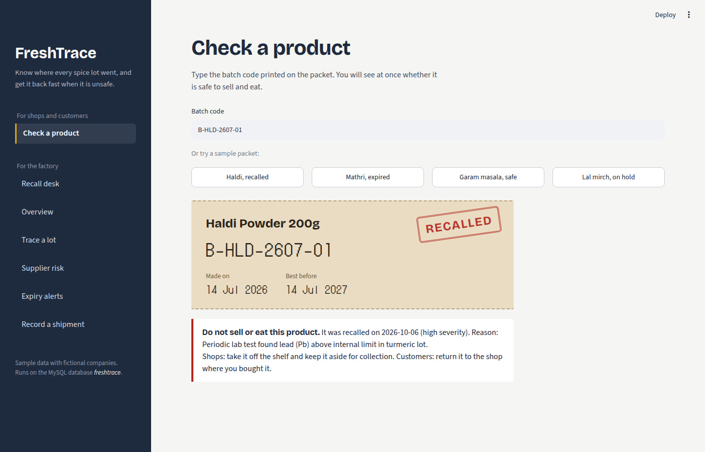

# FreshTrace: Food Batch Traceability & Recall System

FreshTrace is a MySQL database with a Streamlit web app on top. It tracks every raw-material lot from the supplier, through production batches, to every shop that received the finished product. When a lot turns out to be unsafe, the factory can see in seconds which batches and shops are affected, and anyone holding a packet can check if it is safe by typing its batch code.

Built as my DBMS mini project (EDA201-3N), BSc Data Science and Artificial Intelligence, Semester III, CHRIST (Deemed to be University), Delhi NCR.



## The problem

Small food processing units usually track suppliers, production and dispatch in separate registers or spreadsheets. When a raw-material lot fails a lab test, finding every affected batch and every shop that received it can take days. The result is either a slow recall, with unsafe food still on shelves, or an over-broad one that destroys safe stock.

## What the app does

| Page | For | What it does |
|---|---|---|
| Check a product | Shops and customers | Type the batch code from the packet and get SAFE, RECALLED, EXPIRED or ON HOLD, with what to do next |
| Recall desk | Factory quality team | Raise a recall in one transaction, download the call list, track each shop until every unit is back, then close the recall |
| Trace a lot | Factory | Follow any raw-material lot to every batch and shop |
| Supplier risk | Purchase team | Inspection failure rate per supplier, and backup suppliers for the same material |
| Expiry alerts | Warehouse and sales | Lots and batches close to, or past, their expiry |
| Record a shipment | Dispatch | Add a shipment; the database rejects invalid values |
| Overview | Everyone | Key numbers and production volume |

## Database design

12 tables in MySQL, normalized to 3NF:

`supplier`, `raw_material`, `material_lot`, `lot_inspection`, `product`, `production_batch`, `batch_ingredient` (M:N batch-lot), `batch_qc_test`, `retailer`, `shipment` (M:N batch-retailer), `recall` (1:1 with lot), `recall_notice` (M:N recall-retailer).

DBMS concepts used: primary and composite keys, foreign keys with `ON DELETE RESTRICT`, `UNIQUE`, `NOT NULL`, `CHECK` and `DEFAULT` constraints, joins (inner, left, right, self), subqueries (nested, correlated, `EXISTS`, `ANY`/`ALL`), `GROUP BY` / `HAVING`, five views, and transactions (`COMMIT` / `ROLLBACK`). Batch expiry is derived (manufacturing date + shelf life) instead of stored.

## Data

The data is **sample data**: the companies, people, phone numbers and licence numbers are fictional, and test values are illustrative. Real lot-level traceability records are confidential business data, so no public dataset exists. The app is not tied to this data; it works on whatever is in the database.

## Run it on your computer

1. Install MySQL 8 and run `freshtrace_full_setup.sql` once in MySQL Workbench.
2. Install the Python packages: `pip install -r requirements.txt`
3. In `app.py`, put your MySQL password in `DB_CONFIG`.
4. Start the app: `python -m streamlit run app.py`

When deployed on Streamlit Community Cloud, the connection details are read from the app's Secrets instead of the file, so the password never goes to GitHub. The Secrets box looks like this:

```toml
[mysql]
host = "your-db-host"
port = 3306
user = "your-user"
password = "your-password"
database = "freshtrace"
```

## Files

- `app.py`: the Streamlit app
- `freshtrace_full_setup.sql`: creates the database, tables, sample data, views and the recall tracking table in one go
- `requirements.txt`: Python packages
- `preview.png`: screenshot of the Check a product page

## Tech

MySQL 8 · Python · Streamlit · pandas · mysql-connector-python
